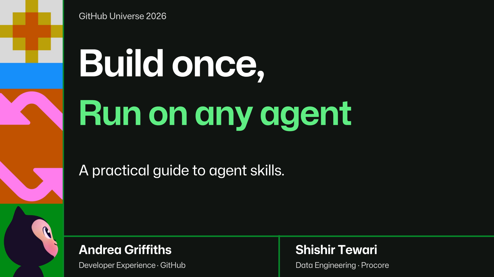

# Build once, run on any agent

**A practical guide to agent skills** · GitHub Universe 2026 · BLD1787B

[Talk site](https://gh.io/skills-talk) · [Slides (PDF)](slides/talk.pdf)

| Speaker | Role |
| --- | --- |
| Andrea Griffiths | Senior Developer Advocate, GitHub |
| Shishir Tewari | Senior Manager, Data Engineering, Procore |

## About the talk

Most developers use AI the same way: open a chat, type a prompt, move on. The context disappears. The next step starts from scratch.

Agent skills fix that. Andrea Griffiths builds them for her own recurring work: files any coding agent can run. Shishir Tewari builds them for a data engineering team at Procore, where a skill has to encode senior-engineer judgment and survive production.

Different scale, same format. The file you write for yourself tonight is the same file that runs a team’s pipeline.

You will leave with a clear model for when to build a skill instead of writing another prompt.

## Demos

| Skill | What it does | Media | Source |
| --- | --- | --- | --- |
| [**proof-agent**](demos/proof-agent/) | Andrea's independent verifier skill and GitHub Action, pinned to `v1.1.2` | [Narrated demo](assets/recordings/proof-agent-narrated.mp4) (3:52) | [AndreaGriffiths11/proof-agent](https://github.com/AndreaGriffiths11/proof-agent) |
| [**dataforge**](demos/dataforge/) | Shishir's four agent skills that build data pipelines from a project manifest, issue to pull request | [Recording](assets/recordings/Dataforge.mp4) | [tewarishishir/dataforge](https://github.com/tewarishishir/dataforge) |

## Also in this repo

[**proof-review**](demos/proof-review/) is not part of the talk. It extends the verifier idea from proof-agent: proof-agent reviews the diff, proof-review reproduces a bugfix claim under production-shaped load and measures whether the PR closes every root cause. Canonical: [AndreaGriffiths11/proof-review](https://github.com/AndreaGriffiths11/proof-review).

For more of Andrea's skills and resources, see [mainbranch.dev/skills](https://mainbranch.dev/skills/).
## Repository layout

| Path | Contents |
| --- | --- |
| [`slides/`](slides/) | The talk deck |
| [`demos/`](demos/) | The skills above, as runnable snapshots |
| [`assets/`](assets/) | Recordings used by the demos and the site |
| [`site/`](site/) | Talk website source and build ([build, deck, and Pages setup](site/README.md)) |
